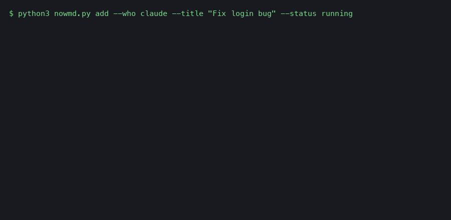

# now-md — one page that tells every AI "what's going on right now"

> Machine-written `NOW.md` for people who juggle Claude, ChatGPT, Codex and Gemini. Each AI drops one tiny JSON per task; one script builds a single hand-off page. No AI, no network, standard library only.

[English](#english) | [日本語](#日本語)



## English

**Who it's for**: people who switch between several AIs (Claude, ChatGPT, Codex, Gemini…) and keep re-explaining "where we are" every time.

How it works: each AI (or you) writes one tiny JSON per task into `tasks/`. A script gathers them into a single **`NOW.md`**. The next AI reads only that page first. `NOW.md` is machine-written (never hand-edited), so the format never drifts and the reader spends few tokens.

`NOW.md` contains: **Running / Stuck (with how to unblock) / Done in the last 24h / Latest notes & decisions** — capped at 120 lines.

### Try it in 30 seconds
```
python3 nowmd.py --dir examples add --who claude --title "Fix login bug" --status running
python3 nowmd.py --dir examples add --who codex --title "Write tests" --status blocked --why "needs API key" --fix "ask the owner for a test key"
python3 nowmd.py --dir examples note "Decision: use SQLite"
cat examples/NOW.md
```
When things change: `python3 nowmd.py --dir examples update --id <id> --status blocked --why "..." --fix "..."`
When finished: `python3 nowmd.py --dir examples done --id <id> --result result.md`
Broken record? `python3 nowmd.py --dir examples check`

New in v0.2: `update` (any status change), collision-proof ids and a lock so several AIs can write at once, `check` for bad JSON/status/dates, ready-made instruction snippets in [`templates/`](templates) (Claude / Codex / Gemini / ChatGPT), a [getting-started guide](docs/GETTING_STARTED.md), and tests (`python3 -m unittest discover -s tests`).

### Tips
- Add one line to your agent instructions (CLAUDE.md / AGENTS.md / GEMINI.md…) — copy from [`templates/`](templates): "Read NOW.md first. Leave one line with `nowmd.py add / update / done / note` at each milestone."
- Run `python3 nowmd.py build` from cron every few minutes; a task stuck in `running` with no update for 60+ min gets a ⚠.
- Old task files can stay; `done` items older than 24h simply drop out of `NOW.md`.

## 日本語

**こんな人向け**: Claude・ChatGPT・Codex・Geminiなど**複数のAIを使い分けていて、AIを替えるたびに「いまどこまで進んだか」を説明し直している**人。

仕組み: 各AI(や自分)が「やること1件=小さなJSON1つ」を `tasks/` に書く。スクリプトがそれらを集めて **`NOW.md` を1枚**作る。次のAIは最初にこの1枚だけ読めばよい。`NOW.md` は手で直さない(機械が書く)ので、書き方がぶれず、読む側のトークンも少なくて済みます。AI・ネット接続なし、標準ライブラリだけ。

`NOW.md` の中身: **動いている作業 / 止まっている作業(戻し方つき)/ 直近24時間に終わった作業 / 最新のメモ・決定**。最大120行。

### 30秒で試す
```
python3 nowmd.py --dir examples add --who claude --title "ログイン不具合を直す" --status running
python3 nowmd.py --dir examples add --who codex --title "テストを書く" --status blocked --why "APIキー待ち" --fix "持ち主にテスト用キーを頼む"
python3 nowmd.py --dir examples note "決定: DBはSQLiteにする"
cat examples/NOW.md
```
状態が変わったら: `python3 nowmd.py --dir examples update --id <id> --status blocked --why "理由" --fix "戻し方"`
終わったら: `python3 nowmd.py --dir examples done --id <id> --result 結果.md`
記録が壊れていないか: `python3 nowmd.py --dir examples check`

v0.2 の新機能: `update`(状態の変更)、IDが重ならない・ロックで複数のAIが同時に書ける、`check`(JSON・状態・日時の検査)、[`templates/`](templates) の指示書の雛形(Claude / Codex / Gemini / ChatGPT)、[はじめかたガイド](docs/GETTING_STARTED.md)、テスト(`python3 -m unittest discover -s tests`)。

### 使い方のコツ
- AIへの指示書(CLAUDE.md / AGENTS.md / GEMINI.md 等)に「作業の最初に NOW.md を読む。節目に `nowmd.py add / update / done / note` で1行残す」と1行書くだけ([`templates/`](templates) からコピー)。
- cron や launchd で `python3 nowmd.py build` を数分おきに回すと、`running` のまま長時間更新が無い作業に ⚠ が付きます。
- `tasks/` の記録は消さずに溜めてOK(24時間より古い `done` は `NOW.md` に出ません)。

## More / 続き
- Repo: https://github.com/kanazawateppei2020-spec/now-md
- Series (Japanese) / 連載マガジン: https://note.com/teppei_lil_white/m/m5d06e069f1fd
- Guide (Japanese, ¥980) / 共通ファイル設計ガイド: https://note.com/teppei_lil_white/n/n3800182145e4
- Author on note: https://note.com/teppei_lil_white

## License
MIT — see [LICENSE](LICENSE).
